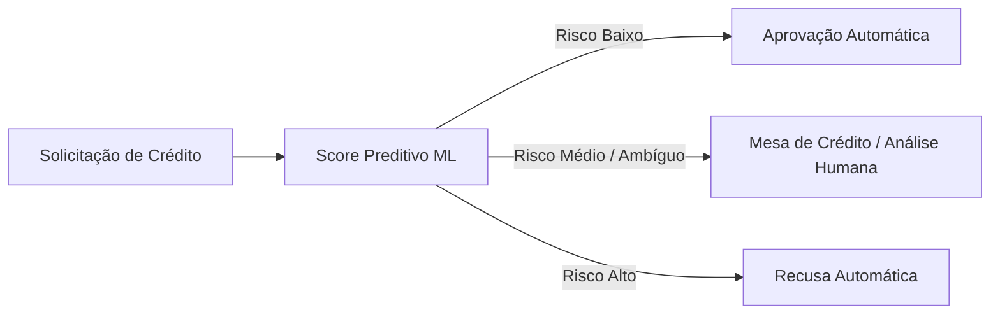

# Tech Challenge — Fase 2 | POSTECH Data Analytics

## 1. Identificação

| Campo | Valor |
|---|---|
| Turma | 2DTATBB |
| Grupo | Grupo 43 |
| Data de entrega | 10/10/2026 |

### Integrantes

| Nome completo | RM | E-mail |
|---|---|---|
| Rejane Brito de Carvalho | RM377775 | rejanebrito@bb.com.br |
| Erica de Abreu Rocha Borges | RM377819 | erica_rocha@bb.com.br |
| Josias Matos de Araujo | RM377801 | matosdearaujo@bb.com.br |
| Monique Oliveira Pereira | RM377781 | mpesousa@yahoo.com |
| Debora Teixeira Pinto | RM377832 | debora.tex@bb.com.br |

---

## 2. Links da entrega

| Item | Link |
|---|---|
| Repositório | https://github.com/matosdearaujo/postech-tech-challenge-fase2-grupo43 |
| Vídeo executivo (≤ 5 min) | https://www.youtube.com/watch?v=4lYs1__UmZ0 |
| Apresentação | `docs/apresentacao_executiva.pdf` — https://canva.link/vyorwi89a0oqsys |

---

## 3. O problema

### 3.1 O trade-off da concessão de crédito

A decisão de aprovar ou recusar crédito envolve custos de erro fortemente assimétricos:

- **Falso Negativo (aprovar mau pagador):** gera perda integral do capital emprestado (*default* / calote direto) — o erro de maior custo operacional.
- **Falso Positivo (recusar bom pagador):** gera custo de oportunidade pela perda de receita futura com juros e tarifas.

Com uma carteira severamente desbalanceada — **98,3% adimplentes** versus **1,7% inadimplentes** —, heurísticas manuais ou regras estáticas tornam-se ineficientes, lentas e incapazes de escalar.

### 3.2 Por que Machine Learning?

A inadimplência decorre de interações **comportamentais** e **multivariadas**:

- **Poder preditivo histórico:** a análise exploratória (EDA) comprovou que atributos comportamentais prévios (`pct_quitado`, `n_meses`) possuem poder preditivo substancialmente superior a variáveis cadastrais estáticas (como renda e idade).
- **Relações não lineares:** modelos de ML mapeiam interações complexas entre dezenas de variáveis que escapam à lógica linear de esteiras tradicionais.
- **Técnicas para classes raras:** permite aplicar balanceamento específico (`scale_pos_weight`, SMOTE) e orientar a otimização para métricas focadas na classe minoritária (**Recall**, **F1-Score** e **AUC-ROC**).

### 3.3 Arquitetura da peneira inteligente

O objetivo do modelo preditivo não é substituir a análise de risco, mas atuar como uma esteira de triagem automatizada:



### 3.4 Variável alvo

**Definição:** `eh_mau_pagador` — variável binária em que `0` = Bom Pagador e `1` = Mau Pagador.

**Construção:** a partir da base `credit_record.csv` (`ID`, `MONTHS_BALANCE`, `STATUS`). Cada cliente possui múltiplos registros mensais de crédito. A regra de rotulagem aplicada foi:

| STATUS original | Significado | Rótulo binário |
| :---: | :--- | :---: |
| `0`, `1`, `C`, `X` | Atraso leve (até 59 dias), quitado ou sem empréstimo | `0` (Bom Pagador) |
| `2`, `3`, `4`, `5` | Atraso igual ou superior a 60 dias | `1` (Mau Pagador) |

Após a binarização, os registros foram agregados por `ID` com `groupby("ID")["eh_mau_pagador"].max().reset_index()`, garantindo um rótulo único por cliente.

**Limiar adotado:** 60 dias de atraso (`STATUS ≥ 2`).

#### Justificativa do limiar e da definição da variável alvo

**1. Racional do limiar operacional (60 dias / STATUS 2 a 5)**

- **Atrasos de 1 a 59 dias (`STATUS` 0 e 1):** configuram oscilações pontuais de liquidez, esquecimentos operacionais ou descasamento temporário de fluxo de caixa. Possuem alta taxa de cura espontânea e rendem encargos moratórios sem comprometer o principal financiado.
- **Atrasos a partir de 60 dias (`STATUS` 2 a 5):** representam a quebra estrutural da capacidade financeira do solicitante. É o ponto de inflexão estatístico em que a taxa de recuperação cai drasticamente e a probabilidade de calote definitivo (*write-off*) cresce de forma exponencial, demandando provisionamento regulatório de perdas contábeis.

**2. Racional da agregação temporal por `.max()`**

Adotou-se o **princípio conservador de risco bancário**:

- **Critério:** um único registro de atraso ≥ 60 dias em qualquer mês da série temporal colapsa o cliente para o rótulo de **Mau Pagador (`1`)**.
- **Objetivo:** forçar os modelos a capturarem a fragilidade sob estresse financeiro, impedindo que um histórico predominantemente adimplente camufle um evento severo de inadimplência.

**3. Distribuição das classes e diretrizes de modelagem**

A consolidação gera uma carteira com assimetria extrema: **~98,3% de Bons Pagadores (`0`)** frente a apenas **~1,7% de Maus Pagadores (`1`)** (ou ~98,5% vs. 1,5% antes do merge final). Esse cenário impõe três decisões analíticas:

- **Abandono da acurácia global:** um modelo trivial que aprove 100% dos pedidos obtém ≈ 98% de acerto matemático, mas alcança Recall zero na inadimplência, liberando todos os calotes e inviabilizando a operação.
- **Métricas focadas na classe rara:** avaliação pautada em **Recall (Sensibilidade)** para estancar perdas do principal financiado, **F1-Score** para balancear precisão e captura, e **ROC-AUC** para mensurar a separação discriminatória global.
- **Compensação algorítmica do desbalanceamento:** treinamento conduzido com técnicas de sobreamostragem da classe minoritária (SMOTE via pipeline) e balanceamento de penalidade nas funções de perda (`scale_pos_weight` ou `class_weight='balanced'`).

---

## 4. Dataset

| Campo | Valor |
| :--- | :--- |
| **Fonte** | Credit Card Approval Prediction — Kaggle |
| **Linhas × colunas** | `application_record.csv`: 438.557 × 18<br>`credit_record.csv`: 1.048.575 × 3<br>**Após merge e tratamento:** 36.457 × 25 |
| **Período / versão** | Histórico mensal de crédito com janela de até 60 meses por cliente (`MONTHS_BALANCE` de −60 a 0, sendo 0 o mês atual) |
| **Licença de uso** | CC0: Public Domain |

### 4.1 Descrição das variáveis

| Variável | Tipo | Descrição |
| :--- | :--- | :--- |
| `ID` | `int64` | Identificador único do cliente — chave de junção entre as duas bases |
| `CODE_GENDER` | `object` | Gênero do cliente (M = masculino, F = feminino) |
| `FLAG_OWN_CAR` | `object` | Indica se o cliente possui carro próprio (Y/N) |
| `FLAG_OWN_REALTY` | `object` | Indica se o cliente possui imóvel próprio (Y/N) |
| `CNT_CHILDREN` | `int64` | Quantidade de filhos — removida por redundância com `CNT_FAM_MEMBERS` (r = 0,88) |
| `AMT_INCOME_TOTAL` | `float64` | Renda anual declarada pelo cliente (em unidades monetárias) |
| `NAME_INCOME_TYPE` | `object` | Tipo de renda (Working, Pensioner, Commercial associate, State servant, etc.) |
| `NAME_EDUCATION_TYPE` | `object` | Nível de escolaridade (Higher education, Secondary, Incomplete higher, etc.) |
| `NAME_FAMILY_STATUS` | `object` | Estado civil (Married, Single, Civil marriage, Separated, Widow) |
| `NAME_HOUSING_TYPE` | `object` | Tipo de moradia (House / apartment, With parents, Municipal apartment, etc.) |
| `DAYS_BIRTH` | `int64` | Idade em dias (valores negativos) — convertida para `AGE_YEARS` |
| `DAYS_EMPLOYED` | `int64` | Tempo de emprego em dias (valores negativos). Contém o valor sentinela 365.243 para inativos/aposentados |
| `FLAG_MOBIL` | `int64` | Indica se o cliente possui celular — constante (100% = 1), removida por variância zero |
| `FLAG_WORK_PHONE` | `int64` | Indica se o cliente possui telefone comercial |
| `FLAG_PHONE` | `int64` | Indica se o cliente possui telefone residencial |
| `FLAG_EMAIL` | `int64` | Indica se o cliente possui e-mail cadastrado |
| `OCCUPATION_TYPE` | `object` | Ocupação profissional (~30% de nulos, preenchidos com "Desconhecido") |
| `CNT_FAM_MEMBERS` | `float64` | Número de membros da família |
| `MONTHS_BALANCE` | `int64` | Mês de referência do registro de crédito (−60 a 0; 0 = mês atual) |
| `STATUS` | `object` | Situação mensal do crédito: 0–5 (atrasos crescentes), C (quitado no mês), X (sem empréstimo no mês) |
| `eh_mau_pagador` | `int64` | Variável alvo binária — 1 se o cliente atingiu atraso ≥ 60 dias em qualquer mês; 0 caso contrário |
| `IS_EMPLOYED_MISSING` | `int64` | Flag derivada de `DAYS_EMPLOYED` — 1 para clientes inativos/aposentados (valor sentinela 365.243) |
| `AGE_YEARS` | `float64` | Idade em anos (derivada de `DAYS_BIRTH` dividido por −365,25) |
| `n_meses` | `float64` | Total de meses com histórico de crédito registrado (exposição ao crédito) |
| `mes_inicial` | `float64` | Primeiro mês do histórico do cliente (mais distante no passado) |
| `mes_final` | `float64` | Último mês do histórico (geralmente 0 = mês atual) |
| `n_X` | `float64` | Quantidade de meses sem empréstimo ativo (`STATUS = X`) |
| `n_C` | `float64` | Quantidade de meses com crédito quitado (`STATUS = C`) |
| `n_0` | `float64` | Quantidade de meses com atraso leve de 1 a 29 dias (`STATUS = 0`) |
| `pct_quitado` | `float64` | Proporção de meses em que o crédito foi quitado (`n_C / n_meses`) — normaliza o comportamento pelo tempo de exposição |

---

## 5. Como reproduzir

```bash
git clone https://github.com/SEU-USUARIO/NOME-DO-REPO.git
cd NOME-DO-REPO
python -m venv .venv

# Linux / macOS
source .venv/bin/activate

# Windows
# .venv\Scripts\activate

pip install -r requirements.txt
jupyter notebook
```

Baixe o dataset e coloque o arquivo bruto em `data/raw/` (os dados **não** são versionados — veja `data/README.md`).

Depois execute os notebooks nesta ordem:

| # | Notebook | O que faz |
|---|---|---|
| 1 | `notebooks/01_eda.ipynb` | Análise exploratória |
| 2 | `notebooks/02_preprocessamento.ipynb` | Limpeza, escala e feature engineering |
| 3 | `notebooks/03_modelagem.ipynb` | Treino e comparação dos modelos |
| 4 | `notebooks/04_avaliacao.ipynb` | Métricas, importância de variáveis e conclusões |

**Semente fixa:** `RANDOM_STATE = 42`, declarada na primeira célula de cada notebook.

Rodar os notebooks na ordem acima, a partir de um ambiente limpo, deve reproduzir exatamente os números da seção 6.

---

## 6. Resultados

### 6.1 Validação cruzada (5-fold, F1-Score na classe minoritária)

Todos os modelos foram avaliados com `cross_val_score(..., cv=5, scoring="f1")` sobre o conjunto de treino, usando `Pipeline`/`ImbPipeline` para evitar vazamento de dados (*scaler* e *SMOTE* ajustados apenas no fold de treino).

| Modelo | F1-Score (CV) | Desvio padrão | Observação |
| :--- | :---: | :---: | :--- |
| **Logistic Regression** | 0,4608 | ± 0,0253 | Boa performance, estável |
| **KNN** | 0,2517 | ± 0,0374 | Pior performance, alta variância |
| **SVC** | 0,4704 | ± 0,0216 | Segundo melhor F1, porém lento |
| **Decision Tree** | 0,1334 | ± 0,0066 | Muito instável |
| **Random Forest** | 0,1893 | ± 0,0214 | Indícios de *overfitting* |
| **XGBoost** | **0,5826** | ± 0,0367 | **Melhor F1-Score** |

### 6.2 Desempenho no conjunto de teste (XGBoost, threshold = 0,30)

| Modelo | Acurácia | Precisão (classe 1) | Recall (classe 1) | F1 (classe 1) | AUC-ROC |
| :--- | :---: | :---: | :---: | :---: | :---: |
| **XGBoost** | 0,99 | 0,62 | 0,54 | 0,58 | 0,9324 |

#### Leitura por classe

| Classe | Precision | Recall | F1-Score | Support |
| :--- | :---: | :---: | :---: | :---: |
| **Bom Pagador (0)** | 0,99 | 0,99 | 0,99 | 7.169 |
| **Mau Pagador (1)** | 0,62 | 0,54 | 0,58 | 123 |
| **Acurácia** | — | — | 0,99 | 7.292 |

### 6.3 Modelo escolhido

**Modelo escolhido:** **XGBoost** (`XGBClassifier` com `scale_pos_weight` ajustado e pipeline com `log1p` em `AMT_INCOME_TOTAL`, `StandardScaler` e `SMOTE`).

**Por quê:**

- Maior F1-Score em validação cruzada (**0,5826**) — margem significativa (> 0,11) sobre o segundo colocado (`SVC`, 0,4704) e o terceiro (`Logistic Regression`, 0,4608).
- A diferença não é ruído: o desvio padrão entre os *folds* é de apenas 0,0367, indicando desempenho estável.
- `AUC-ROC` de 0,93 no teste — excelente capacidade de separação entre as classes, muito acima do limiar de 0,85 considerado "forte" em crédito.
- Captura relações não lineares entre *features* comportamentais e cadastrais que modelos lineares (`Logistic Regression`) não conseguem representar.
- Regularização nativa (`max_depth`, `learning_rate`, `subsample`) e *boosting* combinam árvores fracas em um modelo forte, mitigando o *overfitting* (observado no `Random Forest`).

### 6.4 Métricas priorizadas e racional de negócio

Em bases com desbalanceamento severo (**98,3% de Bons Pagadores** vs. **1,7% de Maus Pagadores**), a acurácia global é estatisticamente ilusória: um classificador ingênuo que aprove 100% dos pedidos atinge ~98,3% de acerto sem detectar um único caso de calote (Recall = 0%). Por essa razão, o pipeline foi desenhado e otimizado com foco exclusivo nas métricas orientadas à classe minoritária e ao controle de risco:

**1. Recall (Sensibilidade) — prioridade crítica**

- **Definição:** mede a proporção de inadimplentes reais que foram interceptados pelo modelo: $\text{Recall} = \dfrac{VP}{VP + FN}$.
- **Impacto do Falso Negativo (FN):** ocorre ao classificar um mau pagador como bom. Gera a perda integral do principal financiado (*write-off* / calote não detectado), configurando o erro de maior custo contábil.
- **Relevância financeira:** cada ponto percentual ganho em Recall estanca diretamente a corrosão de capital da instituição.

**2. Precisão — gestão de atrito comercial**

- **Definição:** avalia a proporção de clientes classificados como alto risco que são de fato maus pagadores: $\text{Precisão} = \dfrac{VP}{VP + FP}$.
- **Impacto do Falso Positivo (FP):** ocorre ao recusar crédito para um bom pagador. Resulta em lucro cessante (perda de receitas de juros, anuidade e tarifas) e insatisfação do cliente.
- **Relevância financeira:** funciona como barreira para evitar o travamento indevido de propostas viáveis, preservando o volume de negócios da esteira comercial.

**3. F1-Score — critério de otimização**

- **Definição:** média harmônica entre Precisão e Recall: $F1 = 2 \times \dfrac{\text{Precisão} \times \text{Recall}}{\text{Precisão} + \text{Recall}}$.
- **Foco na classe rara:** desconsidera os Verdadeiros Negativos (que dominam a distribuição e inflariam a avaliação) e concentra o diagnóstico estritamente na capacidade de triagem dos clientes de risco.
- **Uso técnico:** adotado como métrica balizadora na validação cruzada 5-fold.

**4. AUC-ROC — capacidade discriminatória**

- **Definição:** quantifica o poder de separação e ordenação probabilística entre as classes ao longo de todos os *thresholds* operacionais.
- **Uso técnico:** garante comparação justa e agnóstica entre diferentes famílias de algoritmos antes da definição do corte de decisão.
- **Ressalva metodológica:** em desbalanceamento extremo, o eixo horizontal (FPR) pode ser atenuado pelo excesso de verdadeiros negativos. Nesses cenários, a curva PR-AUC (*Precision-Recall AUC*) fornece diagnóstico complementar de robustez.

#### Por que o limiar de decisão (`threshold = 0,30`) é uma escolha de negócio?

1. **Falha da acurácia pura:** atingir ~98% de acerto aprovando calotes quebraria a operação de crédito da instituição financeira.
2. **Assimetria de custos:** o custo de um calote (FN) é tipicamente ordens de magnitude superior ao lucro marginal obtido em uma operação saudável (FP).
3. **Calibragem do ponto de corte:** fixar o limiar em `0,30` (abaixo do padrão técnico de `0,50`) induz o algoritmo a tolerar mais alarmes falsos em favor de capturar mais devedores em potencial, alinhando a esteira ao apetite de risco da instituição.

---

## 7. Principais conclusões e implicações práticas

### 7.1 Comportamento passado supera dados cadastrais

- **Dominância comportamental:** as variáveis determinantes no modelo são históricas (`mes_final`, `n_meses` e `pct_quitado`).
- **Impacto cadastral quase nulo:** atributos estáticos tradicionais — como renda (`AMT_INCOME_TOTAL`), idade (`AGE_YEARS`) e escolaridade — registraram peso estatístico insignificante na separação de risco.
- **Diretriz de negócio:** a esteira de concessão deve priorizar a captura contínua e a manutenção de séries temporais de pagamento confiáveis, em vez de investir apenas no enriquecimento de cadastros demográficos.

### 7.2 O modelo como peneira de triagem, não juiz final

- **Métricas operacionais:**
  - **Precisão = 0,62:** o modelo acerta cerca de 6 em cada 10 sinalizações de alto risco.
  - **Especificidade = 99%:** alta segurança ao classificar clientes de baixo risco.
  - **Recall = 0,54:** quase metade dos inadimplentes não é capturada de forma automática.
- **Desenho da esteira de crédito:** o algoritmo deve organizar a fila de decisão por faixas de risco:
  - **Risco baixo:** aprovação rápida e automática.
  - **Risco alto:** bloqueio direto na porta de entrada.
  - **Risco médio / casos ambíguos:** encaminhamento compulsório para a mesa de crédito (análise humana).

### 7.3 O ponto de corte (*threshold*) é decisão de negócio

- **Assimetria de custos:**
  - **Falso Negativo (aprovar caloteiro):** gera perda do principal emprestado (perda bruta de capital).
  - **Falso Positivo (recusar bom pagador):** gera perda de receita marginal e juros futuros (lucro cessante).
- **Ajuste de política:** como a perda do principal costuma ser ordens de magnitude superior ao lucro cessante, o limiar deve ser calibrado para baixo (ex.: `threshold = 0,30`), aceitando mais falsos positivos para interceptar mais calotes. O ajuste reflete o apetite de risco da instituição, não uma restrição algorítmica.

### 7.4 Restrição de cobertura (*cold start*)

- **Dependência transacional:** como a modelagem depende de atributos comportamentais, ela pontua apenas solicitantes com crédito ativo prévio.
- **Cobertura da base:** o modelo atende menos de 11% do volume total de cadastros disponíveis.
- **Solução operacional:** clientes novos (*cold start*) demandam réguas de corte mais conservadoras ou modelos secundários baseados em dados cadastrais e birôs de crédito externos (Serasa/Boa Vista).

### 7.5 Ciclo de vida e monitoramento contínuo

- **Degradação temporal:** mudanças em cenários macroeconômicos, dinâmicas de consumo e políticas institucionais depreciam o poder preditivo do modelo ao longo do tempo.
- **Governança pós-deploy:** acompanhamento contínuo de métricas discriminatórias (drift e decaimento de performance) e treinos periódicos são requisitos obrigatórios de sustentação do produto.

---

## 8. Estrutura do repositório

```text
.
├── data/          dados brutos (raw) e tratados (processed) — não versionados
├── notebooks/     análise em ordem numerada
└── docs/          apresentação executiva
```

Detalhes e convenções em [`ESTRUTURA.md`](ESTRUTURA.md). Antes de enviar, percorra o [`CHECKLIST.md`](CHECKLIST.md).

---

## 9. Tecnologias

### 9.1 Ambiente e linguagem

| Tecnologia | Versão | Uso no projeto |
| :--- | :---: | :--- |
| **Python** | 3.11+ | Linguagem base de todos os notebooks |
| **Jupyter Notebook** | — | Ambiente de desenvolvimento e execução dos notebooks |
| **venv** | — | Isolamento de dependências (ambiente virtual) |

### 9.2 Manipulação e análise de dados

| Biblioteca | Uso no projeto |
| :--- | :--- |
| **pandas** | Carregamento, limpeza, *merges*, agregações e *feature engineering* |
| **numpy** | Operações vetorizadas, `log1p`, geração de dados sintéticos |

### 9.3 Visualização

| Biblioteca | Uso no projeto |
| :--- | :--- |
| **matplotlib** | Gráficos base (histogramas, *boxplots*, curvas ROC) |
| **seaborn** | *Heatmaps* de correlação, *boxplots* agrupados, estilização (`whitegrid`) |

### 9.4 Machine Learning

| Biblioteca | Uso no projeto |
| :--- | :--- |
| **scikit-learn** | *Pipelines*, `StandardScaler`, `ColumnTransformer`, `train_test_split`, `cross_val_score`, métricas (`classification_report`, `roc_auc_score`, `RocCurveDisplay`, `ConfusionMatrixDisplay`) e modelos lineares/árvores (`Logistic Regression`, `KNN`, `SVC`, `Decision Tree`, `Random Forest`) |
| **imbalanced-learn** | `SMOTE` e `ImbPipeline` — balanceamento da classe minoritária dentro do *pipeline* (sem vazamento de dados) |
| **xgboost** | Modelo vencedor (`XGBClassifier`) com `scale_pos_weight` para lidar com o desbalanceamento extremo |

### 9.5 Serialização e persistência

| Biblioteca | Uso no projeto |
| :--- | :--- |
| **joblib** | Salvamento e carregamento do melhor modelo (`melhor_modelo.pkl`) |

### 9.6 Bibliotecas padrão (Python)

| Módulo | Uso no projeto |
| :--- | :--- |
| **os** | Verificação de existência de arquivos e caminhos *fallback* |
| **pathlib** | Manipulação de caminhos (`Path`) — portável entre sistemas |

### 9.7 Estrutura de arquivos do projeto

```text
requirements.txt     dependências do projeto (instaladas via pip)
data/raw/            dados brutos (application_record.csv, credit_record.csv)
data/processed/      dataset tratado e modelo serializado
notebooks/           análise em 4 etapas numeradas
docs/                apresentação executiva
```